# Pruebas de Integración en Arquitecturas Basadas en Mensajes y Eventos

**Institución Universitaria ITM, Ingeniería de Sistemas, Aseguramiento de la Calidad**

| | |
|---|---|
| Integrantes | _[Nombre 1]_, _[Nombre 2]_, _[Nombre 3]_ |
| Fecha de ejecución de las pruebas | 1 de noviembre de 2026 |
| Repositorio / código fuente | https://github.com/JuanaOsp28/SistemaPedidos |
| Entorno | Windows 11 Home, Docker 29.3.0 (Docker Desktop), Docker Compose v5.1.0, Node.js 20 (en contenedores), Edge + Playwright para las capturas, Newman 6.2 para la colección Postman |

---

## 1. Introducción y objetivo

Se implementaron dos arquitecturas reactivas para el mismo caso de estudio, un sistema de procesamiento de pedidos:

1. **Arquitectura basada en mensajes con RabbitMQ.** La API publica el comando `ProcessOrder` en la cola `pedidos`, y un worker independiente lo consume.
2. **Arquitectura basada en eventos con Apache Kafka.** La API publica el evento de dominio `OrderCreated` en el tópico `orders.events`, y tres consumidores independientes (inventario, facturación y notificación) reaccionan a él.

Sobre ambas se ejecutaron los casos de prueba de integración obligatorios: CP-01 a CP-06 (funcionales) y CP-07 a CP-12 (propiedades reactivas). La ejecución está automatizada con scripts reproducibles. Cada caso deja un archivo de evidencia con los comandos ejecutados, las respuestas HTTP, el estado del broker y los logs de cada contenedor.

## 2. Arquitecturas implementadas

### 2.1 RabbitMQ

```
Cliente HTTP ──POST /orders──▶ orders-api ──AMQP publish (persistente)──▶ rabbitmq [cola: pedidos]
                                                                              │ AMQP consume (ack manual, prefetch 1)
                                                         ┌────────────────────┴────────────────────┐
                                                notification-worker-1                notification-worker-2 (escalado)
```

| Contenedor | Imagen / tecnología | Puertos | Responsabilidad |
|---|---|---|---|
| `rabbitmq` | `rabbitmq:4-management` | 5672 (AMQP), 15672 (consola) | Broker. Cola `pedidos` durable, volumen persistente |
| `orders-api` | Node.js 20 + Express + amqplib 0.10.9 | 3000 | `POST /orders`: valida, genera `orderId`, publica `ProcessOrder` con publisher confirms y responde `202` |
| `notification-worker` | Node.js 20 + amqplib 0.10.9 | **ninguno** | Consume `pedidos`, simula la notificación (2 a 5 s) y confirma con `ack` manual |

### 2.2 Kafka

```
Cliente HTTP ──POST /orders──▶ orders-api ──Kafka produce (key = orderId)──▶ kafka [tópico orders.events, 3 particiones]
                                                                                  │
                         ┌──────────────────────────┬─────────────────────────────┼──────────────────────────────┐
              inventory-consumer          billing-consumer          notification-consumer          audit-consumer
          (inventory-service-group)   (billing-service-group)   (notification-service-group)   (audit-service-group, posterior)
```

| Contenedor | Imagen / tecnología | Puertos | Responsabilidad |
|---|---|---|---|
| `kafka` | `bitnamilegacy/kafka:3.7` (KRaft) | 29092 (externo), 9092 (interno) | Broker y log de eventos, volumen persistente |
| `kafka-init` | `bitnamilegacy/kafka:3.7` | ninguno | Crea `orders.events` con 3 particiones y termina (código 0) |
| `kafka-ui` | `provectuslabs/kafka-ui:v0.7.2` | 8080 (configurable con `KAFKA_UI_PORT`) | Consola de observación |
| `orders-api` | Node.js 20 + Express + kafkajs 2.2.4 | 3000 | `POST /orders`: valida, genera `orderId`, publica `OrderCreated` y responde `202` |
| `inventory-consumer` | Node.js 20 + kafkajs | **ninguno** | Simula la reserva de inventario |
| `billing-consumer` | Node.js 20 + kafkajs | **ninguno** | Simula la generación de la factura |
| `notification-consumer` | Node.js 20 + kafkajs | **ninguno** | Simula la notificación al cliente |
| `audit-consumer` | Node.js 20 + kafkajs (perfil `late`) | **ninguno** | Consumidor posterior: se inicia después de publicar y lee el log desde el inicio |

Contrato del evento publicado, tomado del log real del broker:

```json
{
  "eventId": "c1722dfc-5e0a-410b-8a14-e67233053f29",
  "eventType": "OrderCreated",
  "eventVersion": "1.0",
  "occurredAt": "2026-11-01T19:21:15.909Z",
  "source": "orders-api",
  "correlationId": "3cecb97c-a1f5-45e7-be43-ef884399c12c",
  "data": { "orderId": "ORD-574AD8C6", "customerName": "Ana", "product": "Teclado mecanico",
            "quantity": 2, "unitPrice": 120000, "total": 240000 }
}
```

### 2.3 Decisiones de diseño relevantes para la calidad

- **Ninguna comunicación directa.** Los consumidores no exponen puertos ni servidores HTTP, y la API solo conoce la dirección del broker.
- **Respuesta `202 Accepted` inmediata.** La API espera únicamente la confirmación del broker (publisher confirms en RabbitMQ, `acks=all` en Kafka), nunca al consumidor.
- **Trazabilidad extremo a extremo.** El header `X-Correlation-Id` (o uno generado) viaja como `correlation_id` AMQP, como header Kafka y dentro del cuerpo del mensaje o evento. Todos los logs incluyen `orderId` y `correlationId`.
- **Tolerancia a fallos de arranque.** La API y los consumidores reintentan la conexión cada 3 s, porque `depends_on` no garantiza que el broker esté listo. Además hay healthchecks en `rabbitmq` y `kafka`.
- **Durabilidad.** La cola es durable, los mensajes son persistentes (`delivery_mode=2`), y hay volúmenes Docker para RabbitMQ y para el log de Kafka.
- **Consumer groups distintos por función en Kafka**, para que los tres consumidores reciban cada evento. Para el reparto de carga se escalan instancias del mismo grupo.

## 3. Montaje del entorno

El entorno se levanta con `docker compose up -d --build` en la carpeta de cada arquitectura. Las evidencias completas del montaje están en `evidencias/rabbitmq/ENTORNO.log` y `evidencias/kafka/ENTORNO.log`.

### 3.1 RabbitMQ

Contenedores en ejecución y puertos expuestos (salida de `docker compose ps`):

```
NAME                             SERVICE               STATUS                    PORTS
orders-api                       orders-api            Up 6 minutes                0.0.0.0:3000->3000/tcp
rabbitmq                         rabbitmq              Up About a minute (healthy) 0.0.0.0:5672->5672/tcp, 0.0.0.0:15672->15672/tcp
rabbitmq-notification-worker-1   notification-worker   Up 46 seconds
```

Logs de arranque:

```
orders-api            | [orders-api] API escuchando en el puerto 3000 | endpoint=POST /orders
orders-api            | [orders-api] Conectado a RabbitMQ | broker=rabbitmq:5672 cola=pedidos durable=true
notification-worker-1 | [notification-worker cb6ba480199b] Conectado a RabbitMQ y escuchando la cola | cola=pedidos prefetch=1 ack=manual
```

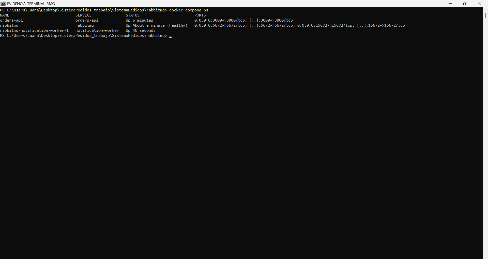

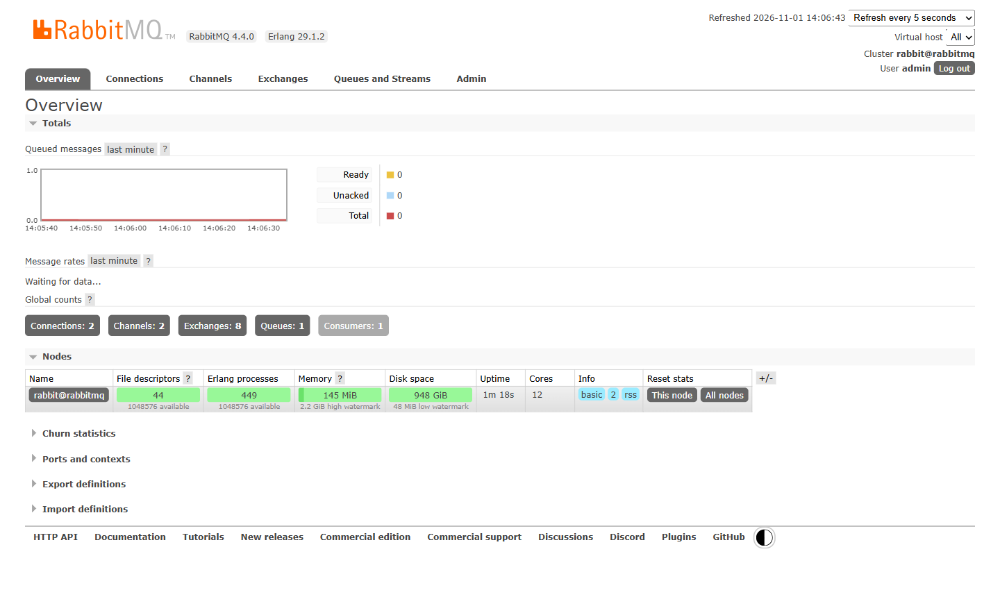

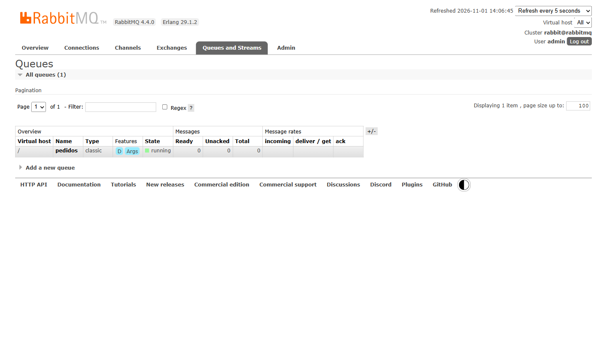

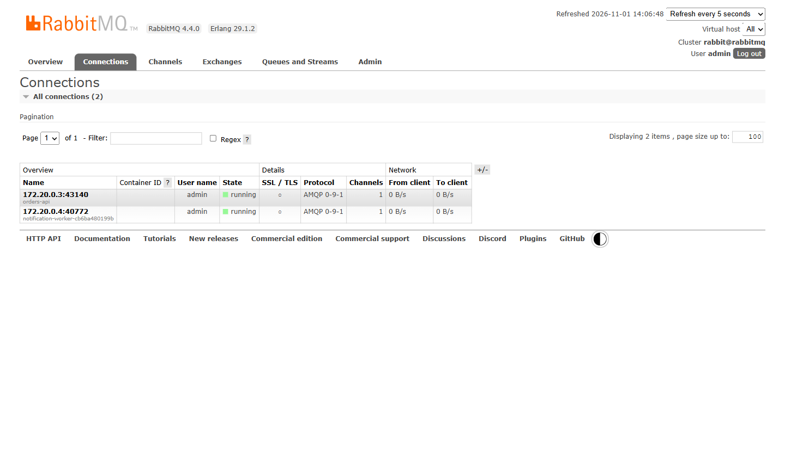

### 3.2 Kafka

```
NAME                            SERVICE                 STATUS                      PORTS
kafka                           kafka                   Up (healthy)                0.0.0.0:29092->29092/tcp
kafka-init                      kafka-init              Exited (0)
kafka-ui                        kafka-ui                Up                          0.0.0.0:8081->8080/tcp
orders-api-kafka                orders-api              Up                          0.0.0.0:3000->3000/tcp
kafka-inventory-consumer-1      inventory-consumer      Up
kafka-billing-consumer-1        billing-consumer        Up
kafka-notification-consumer-1   notification-consumer   Up
```

Broker activo y tópico creado (salida de `kafka-init` y de la API de Kafka UI):

```
kafka-init | Created topic orders.events.
kafka-init | Topic: orders.events  PartitionCount: 3  ReplicationFactor: 1
Kafka UI   | {"name":"local","status":"online","brokerCount":1,"version":"3.7-IV4",...}
```

Logs de arranque de los consumidores, con la asignación de particiones:

```
inventory-consumer-1    | Unido al consumer group | grupo=inventory-service-group particionesAsignadas=0,1,2
billing-consumer-1      | Unido al consumer group | grupo=billing-service-group particionesAsignadas=0,1,2
notification-consumer-1 | Unido al consumer group | grupo=notification-service-group particionesAsignadas=0,1,2
kafka | [GroupCoordinator 1]: Stabilized group inventory-service-group generation 1 (__consumer_offsets-34) with 1 members
```

> En el equipo de la ejecución final el puerto 8080 estaba ocupado por otro servicio de Windows (`AgentService`), así que Kafka UI se publicó en el **8081** con `KAFKA_UI_PORT=8081`. El `docker-compose.yml` y `pruebas/kafka.ps1` usan 8080 por defecto.

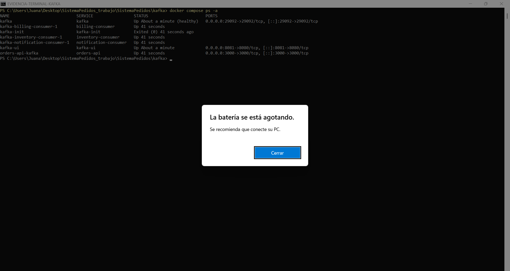

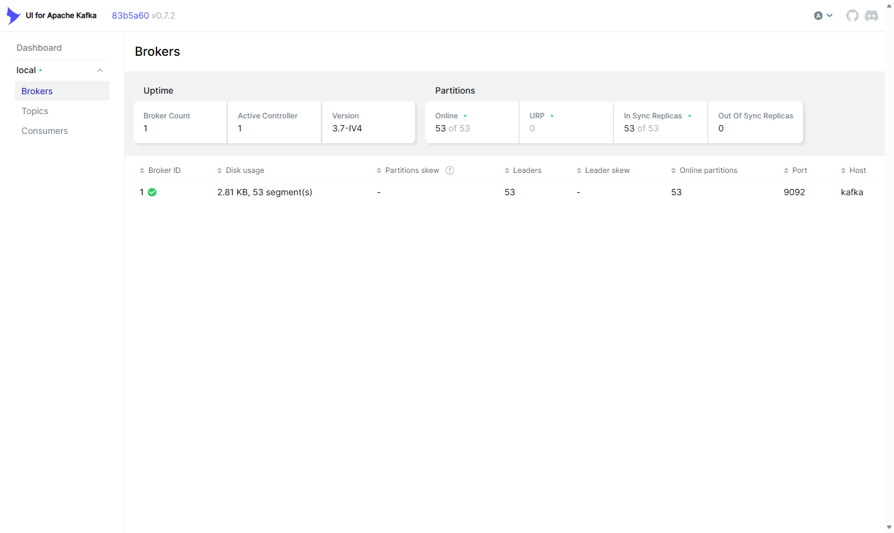

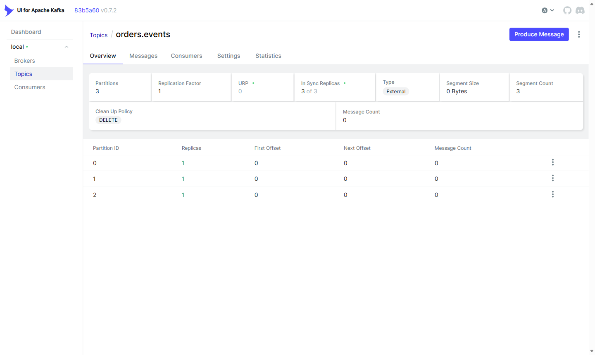

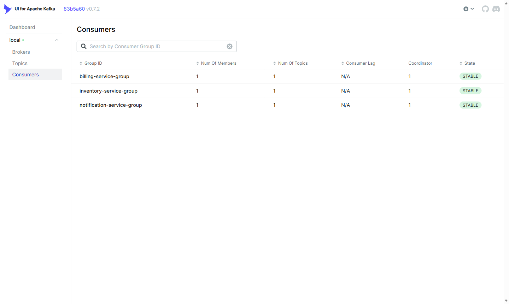

## 4. Estrategia de ejecución

- **Automatización.** `pruebas/rabbitmq.ps1` y `pruebas/kafka.ps1` ejecutan cada caso de principio a fin: preparan el estado, envían pedidos con `curl.exe`, consultan el broker (`rabbitmqctl` y la API de administración de RabbitMQ; `kafka-consumer-groups.sh`, `kafka-get-offsets.sh` y `kafka-console-consumer.sh` en Kafka) y filtran los logs de cada contenedor por `orderId` o `correlationId`.
- **Criterio objetivo.** Cada caso calcula su estado (CUMPLE / NO CUMPLE) a partir de condiciones verificables (códigos HTTP, contadores Ready/Unacked, lag, conteo de líneas de log) y no por inspección visual.
- **Esperas por condición, no por tiempo fijo.** Como el procesamiento es asíncrono, el script espera hasta que la cola se vacía, el lag llega a 0 o aparece la línea de log esperada, con un tiempo máximo.
- **Evidencia.** Cada caso genera `evidencias/<arquitectura>/<caso>.log`. Las capturas están en `evidencias/capturas/`. Se tomaron en el momento exacto de cada caso: el script se detiene en cada punto de captura (`-Pausar`, o la variable `CAPTURA_DIR` para el modo automático), y mientras está detenido Edge, controlado con Playwright, fotografía la consola de RabbitMQ o Kafka UI. La colección de Postman se ejecutó con **Newman**, el ejecutor de línea de comandos de Postman.
- **Ejecución final:** 01/11/2026, RabbitMQ entre las 14:06 y las 14:12 y Kafka entre las 14:20 y las 14:29 (hora de Colombia), sobre volúmenes limpios (`docker compose down -v`). CP-10 de RabbitMQ se volvió a ejecutar a las 14:15 para que la captura mostrara Unacked=2 (la consola actualiza sus contadores cada 5 s).

---

## 5. Casos de prueba: RabbitMQ

### CP-01 · Creación de pedido vía API

| Campo | Contenido |
|---|---|
| **Arquitectura** | RabbitMQ |
| **Objetivo** | Validar que `POST /orders` recibe el pedido, lo valida y responde correctamente |
| **Precondiciones** | `rabbitmq`, `orders-api` y `notification-worker` en ejecución; API conectada al broker |
| **Datos de entrada** | Válido: `{"customerName":"Pedro","product":"Libro de arquitectura","quantity":1}`. Inválido: `{"customerName":"Pedro","quantity":0}`. Mal formado: `{"customerName": "Pedro", ` |
| **Pasos** | 1) POST con el pedido válido. 2) POST con el pedido inválido. 3) POST con el JSON mal formado. 4) Revisar los logs de `orders-api` |
| **Resultado esperado** | Válido: HTTP 202, `status=accepted`, mensaje "Pedido recibido y enviado a RabbitMQ" y un `orderId`. Inválido y mal formado: HTTP 400 |
| **Resultado obtenido** | Válido: **HTTP 202 en 100,7 ms** (primera petición tras el arranque), `orderId=ORD-34247FCC`. Inválido: **HTTP 400** con `["product es obligatorio","quantity debe ser un entero mayor que 0"]`. Mal formado: **HTTP 400** `["JSON mal formado"]` |
| **Evidencia** | `evidencias/rabbitmq/CP-01.log` · Figura CP-01-R (colección Postman ejecutada con Newman: 2 peticiones, 7/7 aserciones) |
| **Estado** | ✅ **Cumple** |
| **Análisis técnico** | La API valida antes de publicar, así que al broker nunca llegan mensajes inválidos. Se usa `202 Accepted` en lugar de `201 Created` porque el pedido queda aceptado para procesarse, pero todavía no está procesado. |

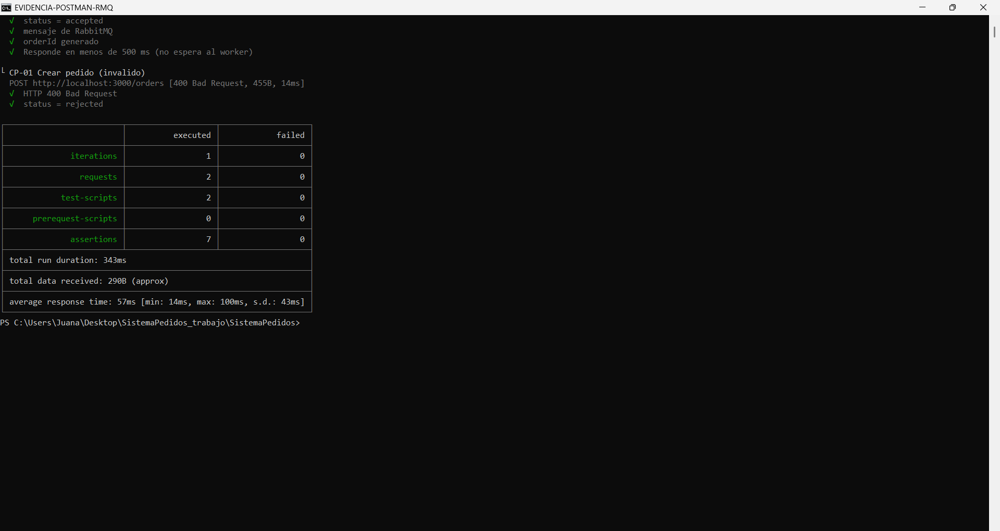

### CP-02 · Envío de mensaje a RabbitMQ

| Campo | Contenido |
|---|---|
| **Arquitectura** | RabbitMQ |
| **Objetivo** | Verificar que el pedido genera un mensaje en la cola `pedidos` |
| **Precondiciones** | Cola vacía; worker detenido (`docker compose stop notification-worker`) para que el mensaje permanezca visible |
| **Datos de entrada** | `{"customerName":"Ana","product":"Teclado","quantity":2}` |
| **Pasos** | 1) Consultar la cola (`rabbitmqctl list_queues`). 2) POST. 3) Consultar la cola otra vez. 4) Leer el mensaje sin consumirlo (`/api/queues/%2F/pedidos/get` con `ack_requeue_true`). 5) Reiniciar el worker |
| **Resultado esperado** | Ready pasa de 0 a 1; el mensaje contiene el `orderId` devuelto por la API y es persistente |
| **Resultado obtenido** | `Ready=0` → **`Ready=1`**. El mensaje en la cola tiene `routing_key=pedidos`, `delivery_mode=2` (persistente), `type=ProcessOrder` y `payload={"type":"ProcessOrder","orderId":"ORD-BD25BC79",...}`. Al reiniciar el worker, la cola volvió a 0 |
| **Evidencia** | `evidencias/rabbitmq/CP-02.log` · Figuras CP-02a y CP-02b |
| **Estado** | ✅ **Cumple** |
| **Análisis técnico** | Se confirma que el productor publica en la cola correcta con las propiedades necesarias para la durabilidad. Detener el worker es la única forma de "congelar" el mensaje para observarlo, porque con el worker activo se consume en milisegundos. |

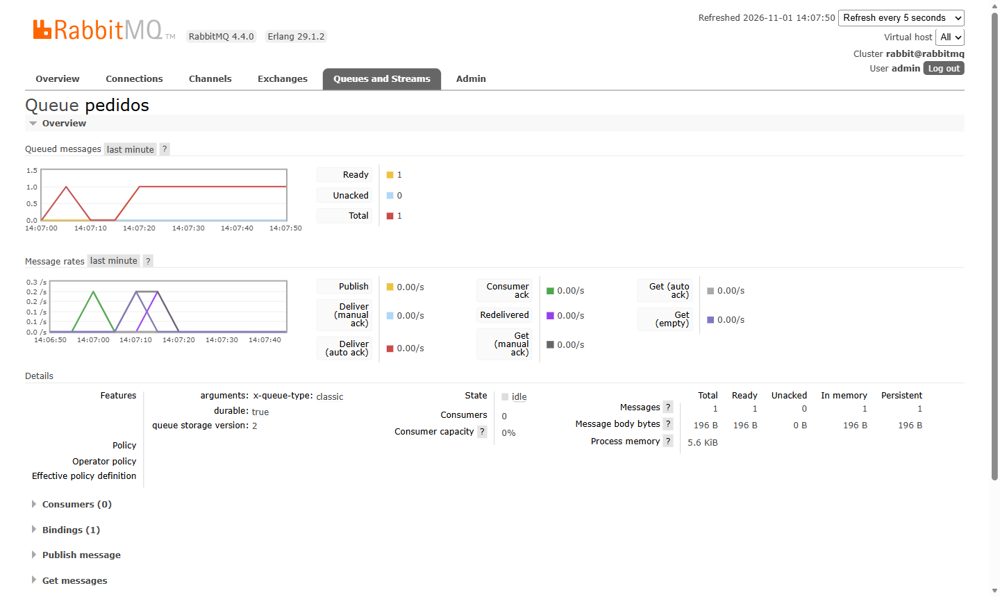

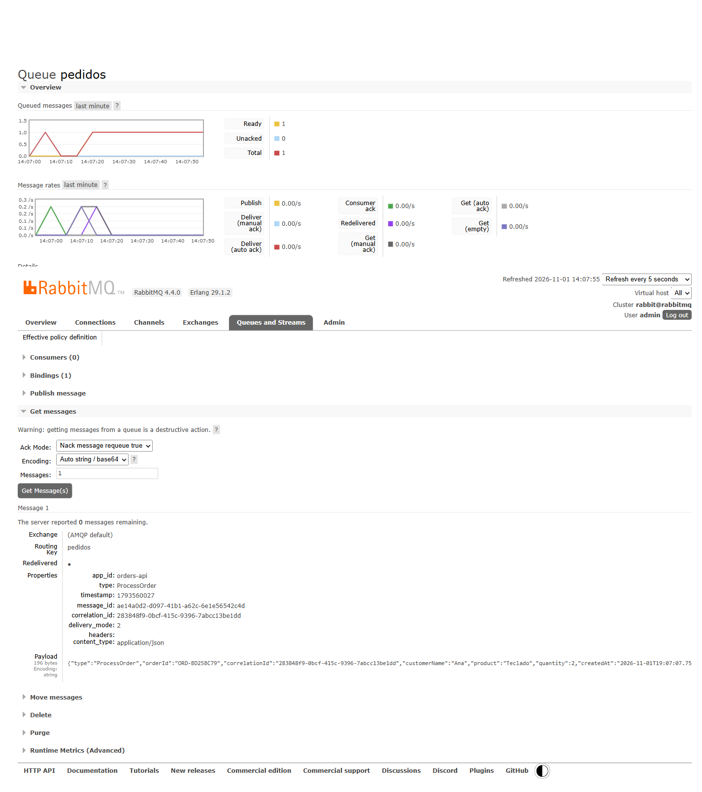

### CP-03 · Consumo de mensaje

| Campo | Contenido |
|---|---|
| **Arquitectura** | RabbitMQ |
| **Objetivo** | Validar que el consumidor procesa el mensaje y lo confirma |
| **Precondiciones** | Worker activo, cola vacía |
| **Datos de entrada** | `{"customerName":"Luis","product":"Monitor","quantity":1}` |
| **Pasos** | 1) POST. 2) Consultar la cola a los 0,7 s (durante el procesamiento). 3) Esperar el log de `ack`. 4) Consultar la cola |
| **Resultado esperado** | Durante el procesamiento Unacked=1; después del `ack`, Total=0; logs de recepción, procesamiento y confirmación |
| **Resultado obtenido** | Durante: **`Ready=0 Unacked=1`**. Después: **`Total=0`**. Log: `Notificacion enviada; mensaje confirmado (ack) \| orderId=ORD-7E5836D0` (procesamiento simulado de 2622 ms) |
| **Evidencia** | `evidencias/rabbitmq/CP-03.log` |
| **Estado** | ✅ **Cumple** |
| **Análisis técnico** | El estado `Unacked` demuestra el ack manual: el broker entregó el mensaje, pero no lo elimina hasta que el worker termina. Esa es la base de la recuperación del CP-12. |

### CP-06 · Trazabilidad del flujo

| Campo | Contenido |
|---|---|
| **Arquitectura** | RabbitMQ |
| **Objetivo** | Seguir un mismo pedido (`orderId` / `correlationId`) en la API, el broker y el consumidor |
| **Precondiciones** | Worker detenido al publicar, para poder observar el mensaje dentro del broker |
| **Datos de entrada** | Header `X-Correlation-Id: QA-RMQ-CP06-140819`; cuerpo `{"customerName":"Marta","product":"Silla ergonomica","quantity":1}` |
| **Pasos** | 1) POST con el header. 2) Filtrar los logs de la API. 3) Leer el mensaje en la cola. 4) Iniciar el worker y filtrar sus logs |
| **Resultado esperado** | El mismo `orderId` y `correlationId` aparecen en los tres puntos |
| **Resultado obtenido** | **API:** `Pedido recibido` y `Mensaje ProcessOrder publicado \| orderId=ORD-41AFB316 correlationId=QA-RMQ-CP06-140819 tiempoMs=4.4`. **Broker:** `correlation_id=QA-RMQ-CP06-140819`, `payload.orderId=ORD-41AFB316`. **Worker:** `Mensaje recibido` y `confirmado (ack) \| orderId=ORD-41AFB316 correlationId=QA-RMQ-CP06-140819` |
| **Evidencia** | `evidencias/rabbitmq/CP-06.log` |
| **Estado** | ✅ **Cumple** |
| **Análisis técnico** | El `correlationId` lo fija el cliente y se propaga sin cambios. Observación: el worker reportó `redelivered=true` porque la lectura del paso 3 (*Get messages* con reencolado) cuenta como una entrega. Es un efecto de la observación, no un fallo. |

### CP-07 · Responsive

| Campo | Contenido |
|---|---|
| **Arquitectura** | RabbitMQ |
| **Objetivo** | Demostrar que la API responde sin esperar al consumidor |
| **Precondiciones** | Worker activo, con procesamiento simulado de 2 a 5 s por mensaje |
| **Datos de entrada** | 5 pedidos seguidos con el worker activo y 3 pedidos con el worker detenido |
| **Pasos** | 1) Enviar 5 POST seguidos midiendo el tiempo. 2) Consultar la cola. 3) Detener el worker y enviar 3 POST más |
| **Resultado esperado** | Todas las respuestas 202 en mucho menos tiempo que el procesamiento mínimo (2000 ms) |
| **Resultado obtenido** | **8/8 respuestas 202; promedio 17,5 ms; máximo 34,5 ms.** Las 5 respuestas llegaron en 0,5 s, mientras que el worker tardó **17,5 s** en vaciar la cola (duraciones registradas: 2091, 2243, 3730, 3072 y 4435 ms). Justo después de responder, la cola estaba en `Ready=4 Unacked=1` |
| **Evidencia** | `evidencias/rabbitmq/CP-07.log` |
| **Estado** | ✅ **Cumple** |
| **Análisis técnico** | El tiempo de respuesta es unas 100 veces menor que el procesamiento y no cambia con el worker apagado. La latencia percibida por el cliente queda desacoplada de la del consumidor. |

### CP-08 · Message-driven

| Campo | Contenido |
|---|---|
| **Arquitectura** | RabbitMQ |
| **Objetivo** | Verificar que no existe comunicación directa entre la API y el worker |
| **Precondiciones** | Entorno completo en ejecución |
| **Datos de entrada** | No aplica |
| **Pasos** | 1) `docker compose ps` (puertos). 2) `netstat -tln` dentro del worker. 3) Desde `orders-api`, intentar una conexión TCP a `notification-worker:3000`. 4) Buscar llamadas HTTP en el código de la API. 5) Listar las conexiones del broker |
| **Resultado esperado** | El worker no expone ni escucha puertos; el intento de conexión falla; no hay llamadas HTTP; ambos servicios solo están conectados al broker |
| **Resultado obtenido** | El worker no publica puertos y `netstat` solo muestra el DNS interno de Docker. La conexión desde la API devuelve **`ECONNREFUSED`**. La búsqueda en el código no encuentra coincidencias. Conexiones del broker: `orders-api → rabbitmq:5672 (AMQP 0-9-1)` y `notification-worker-cb6ba480199b → rabbitmq:5672 (AMQP 0-9-1)` |
| **Evidencia** | `evidencias/rabbitmq/CP-08.log` · Figura E-R2c (*Connections*: solo dos conexiones AMQP hacia el broker) |
| **Estado** | ✅ **Cumple** |
| **Análisis técnico** | La única vía entre productor y consumidor es la cola. Aunque estén en la misma red Docker, el worker no ofrece ninguna interfaz que la API pueda invocar. |

### CP-09 · Resilient

| Campo | Contenido |
|---|---|
| **Arquitectura** | RabbitMQ |
| **Objetivo** | Verificar que el sistema soporta la caída del consumidor |
| **Precondiciones** | Worker activo y cola vacía |
| **Datos de entrada** | 5 pedidos (`Resiliencia1` a `Resiliencia5`) |
| **Pasos** | 1) `docker compose kill notification-worker` (SIGKILL). 2) Enviar 5 POST. 3) Consultar `/health` y la cola. 4) Iniciar el worker |
| **Resultado esperado** | La API sigue respondiendo 202, la cola retiene los mensajes y nada se pierde |
| **Resultado obtenido** | **5/5 respuestas 202** con el worker caído; `/health` respondió 200. Cola: **`Ready=5 Consumidores=0`**. Al iniciar el worker se confirmaron los 5 mensajes y la cola terminó en `Total=0` |
| **Evidencia** | `evidencias/rabbitmq/CP-09.log` · Figura CP-09-R |
| **Estado** | ✅ **Cumple** |
| **Análisis técnico** | La caída del consumidor no se propaga al productor ni al cliente. El broker actúa como amortiguador. |

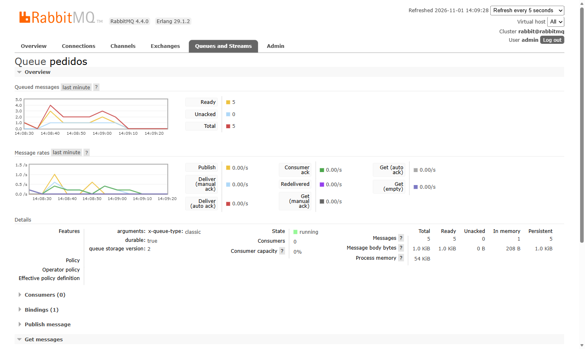

### CP-10 · Elastic

| Campo | Contenido |
|---|---|
| **Arquitectura** | RabbitMQ |
| **Objetivo** | Verificar la distribución de carga entre varios consumidores |
| **Precondiciones** | `docker compose up -d --scale notification-worker=2` |
| **Datos de entrada** | 10 pedidos (`Carga1` a `Carga10`) |
| **Pasos** | 1) Escalar a 2 workers. 2) Enviar 10 POST. 3) Consultar la cola. 4) Contar los `ack` de cada worker. 5) Volver a 1 worker |
| **Resultado esperado** | Ambos workers procesan mensajes, sin duplicados, y el total es 10 |
| **Resultado obtenido** | Cola: `Consumidores=2`; justo después de publicar, **`Ready=6 Unacked=2`** (un mensaje en curso por worker). Reparto: **`notification-worker-2=6`, `notification-worker-1=4`** (10/10, sin duplicados). En la primera corrida de la misma fecha el reparto fue 6/4 en el sentido inverso |
| **Evidencia** | `evidencias/rabbitmq/CP-10.log` · Figura CP-10-R |
| **Estado** | ✅ **Cumple** |
| **Análisis técnico** | Con `prefetch(1)` RabbitMQ entrega el siguiente mensaje al worker que queda libre (consumidores en competencia), así que el reparto es por mensaje y se adapta a la velocidad de cada instancia: el worker que sacó tiempos de procesamiento más cortos atendió más mensajes (6 frente a 4). Escalar no requirió cambiar código ni la configuración del productor. |

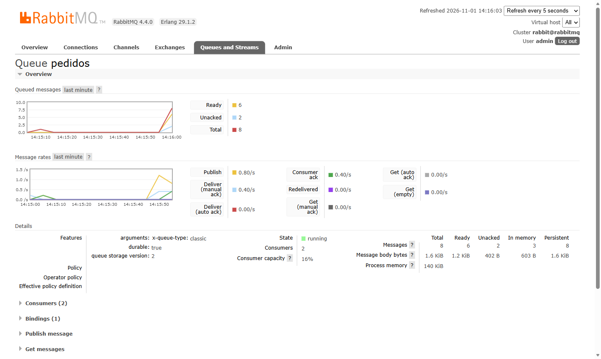

### CP-11 · Desacoplamiento temporal

| Campo | Contenido |
|---|---|
| **Arquitectura** | RabbitMQ |
| **Objetivo** | Verificar que los mensajes publicados con el consumidor apagado se procesan cuando este se inicia |
| **Precondiciones** | Worker detenido |
| **Datos de entrada** | 4 pedidos (`Temporal1` a `Temporal4`) |
| **Pasos** | 1) Detener el worker. 2) Enviar 4 POST. 3) Esperar 10 s. 4) Iniciar el worker. 5) Verificar el `ack` de cada `orderId` |
| **Resultado esperado** | Los 4 mensajes permanecen en la cola y se procesan al iniciar el worker |
| **Resultado obtenido** | **`Ready=4`** al publicar y **`Ready=4`** 10 s después. Al iniciar el worker se procesaron **4/4**: ORD-781A9612, ORD-5087833B, ORD-B900FA84 y ORD-997F3495. La cola terminó en 0 |
| **Evidencia** | `evidencias/rabbitmq/CP-11.log` · Figura CP-11-R |
| **Estado** | ✅ **Cumple** |
| **Análisis técnico** | El productor y el consumidor no necesitan estar activos al mismo tiempo. El orden de procesamiento coincidió con el de publicación (FIFO). |

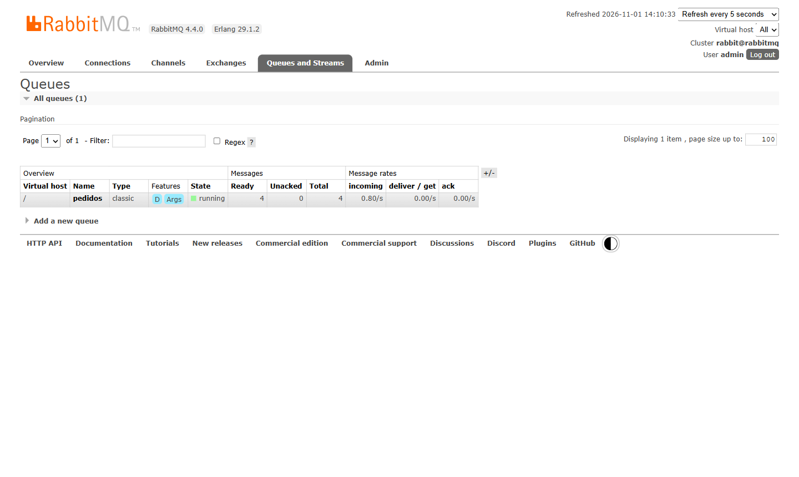

### CP-12 · Recuperación

| Campo | Contenido |
|---|---|
| **Arquitectura** | RabbitMQ |
| **Objetivo** | Verificar que, tras reiniciar el consumidor o el broker, los mensajes no confirmados o pendientes se procesan sin pérdida |
| **Precondiciones** | Entorno completo; cola durable y mensajes persistentes |
| **Datos de entrada** | A) 3 pedidos `Recuperacion*`. B) 3 pedidos `Broker*` |
| **Pasos** | **A)** 1) Enviar 3 POST. 2) Cuando el worker está procesando el primero, `docker compose kill notification-worker`. 3) Consultar la cola. 4) Iniciar el worker. **B)** 1) Detener el worker. 2) Enviar 3 POST. 3) `docker compose restart rabbitmq`. 4) Consultar la cola. 5) Iniciar el worker |
| **Resultado esperado** | A) El mensaje sin ack vuelve a la cola y se reentrega. B) Los mensajes sobreviven al reinicio del broker. En ambos casos no se pierde nada |
| **Resultado obtenido** | **A)** Durante el procesamiento `Ready=2 Unacked=1`. El primer pedido (ORD-35928AFD) ya estaba confirmado y el SIGKILL llegó mientras el worker procesaba el segundo; tras la caída, **`Ready=2 Unacked=0`** (el mensaje en curso volvió a la cola). Al reiniciar el worker: `Mensaje recibido \| orderId=ORD-F0533005 ... redelivered=true`; se confirmaron los 3, sin pérdidas. **B)** `Ready=3` antes del reinicio y **`Ready=3` después**. La API registró `Conexion con RabbitMQ cerrada` → 3 reintentos (`ECONNREFUSED`) → `Conectado a RabbitMQ` (12 s, sin reiniciar la API). Se procesaron los 3, sin pérdidas |
| **Evidencia** | `evidencias/rabbitmq/CP-12.log` · Figura CP-12-R |
| **Estado** | ✅ **Cumple** |
| **Análisis técnico** | Con ack manual, la garantía es "al menos una vez" a nivel de mensaje: solo se reentrega el mensaje que estaba en curso, y el broker lo marca con `redelivered=true`, lo que permite que el consumidor detecte un posible duplicado. La durabilidad combina tres elementos: cola durable, `persistent: true` y volumen en `/var/lib/rabbitmq`. Si falta cualquiera de los tres, el caso B falla. |


---

## 6. Casos de prueba: Kafka

### CP-01 · Creación de pedido vía API

| Campo | Contenido |
|---|---|
| **Arquitectura** | Kafka |
| **Objetivo** | Validar que `POST /orders` recibe el pedido, lo valida y responde correctamente |
| **Precondiciones** | `kafka`, `orders-api` y los consumidores en ejecución; tópico creado |
| **Datos de entrada** | Válido: `{"customerName":"Pedro","product":"Libro de arquitectura","quantity":1,"unitPrice":85000}`. Inválido: `{"customerName":"Pedro","product":"Libro","quantity":-2}`. Mal formado: `{"customerName": "Pedro", ` |
| **Pasos** | 1) POST válido. 2) POST inválido. 3) POST mal formado. 4) Revisar los logs de `orders-api` |
| **Resultado esperado** | Válido: HTTP 202, `status=accepted`, mensaje "Pedido recibido y evento OrderCreated publicado en Kafka" y un `orderId`. Inválido y mal formado: HTTP 400 |
| **Resultado obtenido** | Válido: **HTTP 202 en 264,9 ms** (primera publicación: incluye la obtención de metadatos del tópico), `orderId=ORD-E414562D`. Inválido: **HTTP 400** (quantity y unitPrice). Mal formado: **HTTP 400** |
| **Evidencia** | `evidencias/kafka/CP-01.log` · Figura CP-01-K (colección Postman ejecutada con Newman: 2 peticiones, 7/7 aserciones) |
| **Estado** | ✅ **Cumple** |
| **Análisis técnico** | Igual que en RabbitMQ, la validación ocurre antes de publicar: ningún evento inválido llega al log, que es inmutable. Esto es más importante en Kafka, porque un evento publicado no se puede borrar y todos los grupos lo leerían. |

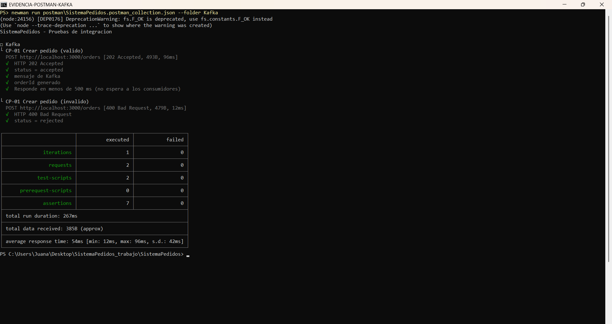

### CP-04 · Publicación de evento en Kafka

| Campo | Contenido |
|---|---|
| **Arquitectura** | Kafka |
| **Objetivo** | Verificar que se genera el evento `OrderCreated` en `orders.events` con su contrato completo |
| **Precondiciones** | Tópico `orders.events` con 3 particiones |
| **Datos de entrada** | `{"customerName":"Ana","product":"Teclado mecanico","quantity":2,"unitPrice":120000}` |
| **Pasos** | 1) `kafka-get-offsets.sh` antes. 2) POST. 3) `kafka-get-offsets.sh` después. 4) Leer el evento del log con `kafka-console-consumer.sh`. 5) Validar los campos |
| **Resultado esperado** | El log crece en 1; el evento tiene `eventType=OrderCreated`, los campos obligatorios y `total = quantity × unitPrice` |
| **Resultado obtenido** | Eventos en el tópico: **1 → 2**. API: `Evento OrderCreated publicado \| orderId=ORD-574AD8C6 eventId=c1722dfc-… particion/offset`. En el broker: `Partition:0 Offset:1`, headers `eventType:OrderCreated, eventId, correlationId`, key `ORD-574AD8C6`. Campos `eventId`, `eventType`, `eventVersion=1.0`, `occurredAt`, `source=orders-api`, `correlationId` y `data` presentes; **`total=240000`** |
| **Evidencia** | `evidencias/kafka/CP-04.log` · Figuras CP-04a y CP-04b |
| **Estado** | ✅ **Cumple** |
| **Análisis técnico** | El evento está nombrado como un hecho en pasado y lleva metadatos de trazabilidad e idempotencia (`eventId`). La key `orderId` garantiza que todos los eventos de un mismo pedido caigan en la misma partición y conserven el orden. |

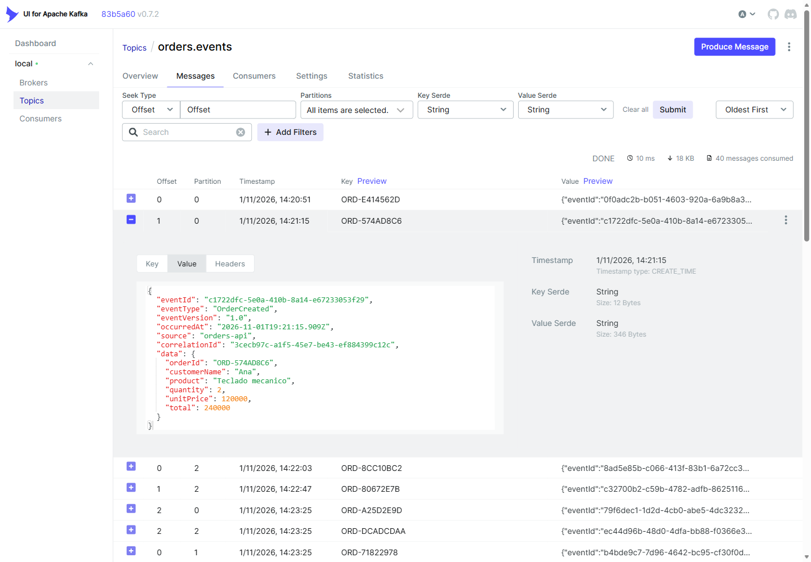


### CP-05 · Consumo de evento

| Campo | Contenido |
|---|---|
| **Arquitectura** | Kafka |
| **Objetivo** | Validar que cada consumidor recibe el evento |
| **Precondiciones** | Los 3 consumidores activos, cada uno en su propio grupo |
| **Datos de entrada** | `{"customerName":"Luis","product":"Monitor 27","quantity":1,"unitPrice":950000}` |
| **Pasos** | 1) POST. 2) Esperar `Evento procesado` en cada consumidor. 3) Describir los 3 consumer groups |
| **Resultado esperado** | Los 3 consumidores reciben el **mismo** evento (mismo `eventId`) y ejecutan su acción; lag 0 |
| **Resultado obtenido** | **3/3** recibieron `eventId=8ad5e85b-c066-413f-83b1-6a72cc3138bf` de `ORD-8CC10BC2` (partición 2, offset 0). inventory: `Inventario reservado`; billing: `Factura generada`; notification: `Notificacion enviada al cliente`. **Lag 0** en `inventory-service-group`, `billing-service-group` y `notification-service-group` |
| **Evidencia** | `evidencias/kafka/CP-05.log` · Figura CP-05 |
| **Estado** | ✅ **Cumple** |
| **Análisis técnico** | Cada grupo mantiene sus propios offsets, así que el mismo evento se entrega a todos (difusión). La API no sabe cuántos consumidores existen: agregar uno nuevo no requiere cambiarla. |

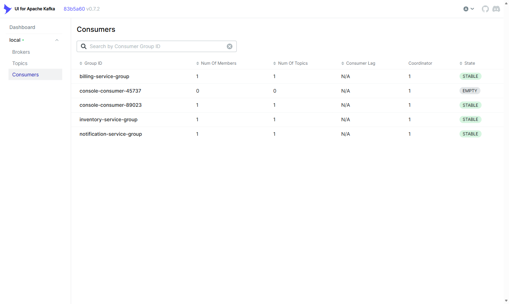

### CP-06 · Trazabilidad del flujo

| Campo | Contenido |
|---|---|
| **Arquitectura** | Kafka |
| **Objetivo** | Seguir un mismo pedido en la API, el broker y los consumidores |
| **Precondiciones** | Entorno completo |
| **Datos de entrada** | Header `X-Correlation-Id: QA-KAFKA-CP06-142247`; cuerpo `{"customerName":"Marta","product":"Silla ergonomica","quantity":1,"unitPrice":700000}` |
| **Pasos** | 1) POST con el header. 2) Logs de la API. 3) Leer el evento en el broker. 4) Logs de los 3 consumidores |
| **Resultado esperado** | El mismo `orderId`, `eventId` y `correlationId` en todos los puntos, con la misma partición y el mismo offset |
| **Resultado obtenido** | **API:** `publicado \| orderId=ORD-80672E7B eventId=c32700b2-… correlationId=QA-KAFKA-CP06-142247 particion=2 offset=1`. **Broker:** `Partition:2 Offset:1 eventType:OrderCreated,eventId:c32700b2-…,correlationId:QA-KAFKA-CP06-142247 ORD-80672E7B {...}`. **Consumidores (3/3):** `Evento recibido \| eventId=c32700b2-… orderId=ORD-80672E7B correlationId=QA-KAFKA-CP06-142247 partition=2 offset=1` |
| **Evidencia** | `evidencias/kafka/CP-06.log` |
| **Estado** | ✅ **Cumple** |
| **Análisis técnico** | En Kafka la pareja (partición, offset) identifica el evento de forma única en el broker y cruza con exactitud los registros de productor y consumidores. Leer el log no altera nada (a diferencia del *Get messages* de RabbitMQ). |

### CP-07 · Responsive

| Campo | Contenido |
|---|---|
| **Arquitectura** | Kafka |
| **Objetivo** | Demostrar que la API responde sin esperar a los consumidores |
| **Precondiciones** | Procesamiento simulado: inventario 1500 ms, facturación 1000 ms, notificación 800 ms por evento |
| **Datos de entrada** | 5 pedidos seguidos y 3 pedidos con los 3 consumidores detenidos |
| **Pasos** | 1) 5 POST midiendo el tiempo. 2) Consultar el lag. 3) Detener los consumidores y enviar 3 POST |
| **Resultado esperado** | 8/8 respuestas 202 en menos de 800 ms (el procesamiento más corto) |
| **Resultado obtenido** | **8/8 respuestas 202; promedio 17,9 ms; máximo 43 ms.** Las 5 respuestas llegaron en 0,4 s, con el lag en ese momento en `inventory=4 billing=4 notification=0`. Los consumidores tardaron **17,7 s** en ponerse al día |
| **Evidencia** | `evidencias/kafka/CP-07.log` |
| **Estado** | ✅ **Cumple** |
| **Análisis técnico** | El lag distinto de cero en el instante de la respuesta prueba que la API respondió antes de que los consumidores terminaran. La latencia del cliente no depende del consumidor más lento. |

### CP-08 · Message-driven

| Campo | Contenido |
|---|---|
| **Arquitectura** | Kafka |
| **Objetivo** | Verificar que no existe comunicación directa entre la API y los consumidores |
| **Precondiciones** | Entorno completo |
| **Datos de entrada** | No aplica |
| **Pasos** | 1) `docker compose ps` (puertos). 2) `netstat -tln` en los 3 consumidores. 3) Desde la API, conexión TCP a cada consumidor. 4) Variables de entorno y código de la API. 5) Consumer groups |
| **Resultado esperado** | Ningún consumidor expone ni escucha puertos; las conexiones fallan; la API solo conoce `kafka:9092` |
| **Resultado obtenido** | Consumidores sin puertos. Intentos de conexión: `inventory-consumer`, `billing-consumer` y `notification-consumer`, todos **`ECONNREFUSED`**. `printenv`: `KAFKA_BROKER=kafka:9092`, `KAFKA_TOPIC=orders.events`. La búsqueda en el código no encuentra coincidencias. Cada consumidor aparece solo como miembro de su grupo en el broker |
| **Evidencia** | `evidencias/kafka/CP-08.log` |
| **Estado** | ✅ **Cumple** |
| **Análisis técnico** | El acoplamiento entre servicios es solo con el contrato del evento y el nombre del tópico. Ningún servicio conoce la dirección de otro. |

### CP-09 · Resilient

| Campo | Contenido |
|---|---|
| **Arquitectura** | Kafka |
| **Objetivo** | Verificar que el sistema soporta la caída de un consumidor |
| **Precondiciones** | Los 3 consumidores activos con lag 0 |
| **Datos de entrada** | 3 pedidos (`Resiliencia1` a `Resiliencia3`) |
| **Pasos** | 1) `docker compose kill billing-consumer`. 2) Enviar 3 POST. 3) Verificar que inventory y notification procesan. 4) Consultar el lag. 5) Iniciar billing |
| **Resultado esperado** | La API acepta; los otros consumidores siguen funcionando; billing acumula lag y lo recupera al volver |
| **Resultado obtenido** | **3/3 respuestas 202.** inventory y notification procesaron **6/6** (3 cada uno). Lag: `inventory=0 billing=3 notification=0`; `billing-service-group` sin miembros activos (estado `EMPTY` en Kafka UI). Al reiniciar billing se generaron **3 facturas** y el lag llegó a 0 |
| **Evidencia** | `evidencias/kafka/CP-09.log` · Figura CP-09-K |
| **Estado** | ✅ **Cumple** |
| **Análisis técnico** | La falla queda aislada en un solo grupo: ni la API ni los otros consumidores se ven afectados (desacoplamiento total). El lag es una métrica directa del trabajo pendiente del servicio caído. |

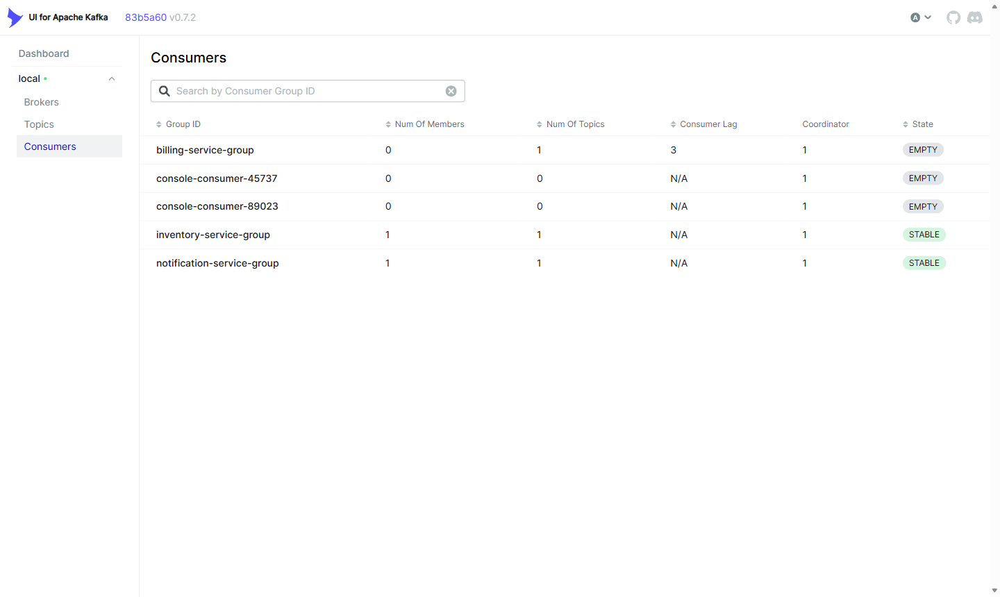

### CP-10 · Elastic

| Campo | Contenido |
|---|---|
| **Arquitectura** | Kafka |
| **Objetivo** | Verificar el reparto de carga con varias instancias del mismo consumer group |
| **Precondiciones** | `docker compose up -d --scale inventory-consumer=2`; tópico con 3 particiones |
| **Datos de entrada** | 12 pedidos (`Carga1` a `Carga12`) |
| **Pasos** | 1) Escalar a 2 instancias. 2) Verificar el rebalanceo. 3) Enviar 12 POST. 4) Contar los eventos procesados por instancia. 5) Volver a 1 instancia |
| **Resultado esperado** | Las particiones se reparten entre las 2 instancias, cada evento se procesa una sola vez dentro del grupo y el total es 12 |
| **Resultado obtenido** | Rebalanceo: `inventory-consumer-2` → **particiones 0,2**; `inventory-consumer-1` → **partición 1** (confirmado con `--describe --members`: `orders.events(0,2)` y `orders.events(1)`). Procesados: **`inventory-consumer-1=5`, `inventory-consumer-2=7`** (12/12, sin duplicados) |
| **Evidencia** | `evidencias/kafka/CP-10.log` · Figura CP-10-K |
| **Estado** | ✅ **Cumple** |
| **Análisis técnico** | En Kafka la unidad de paralelismo es la **partición**, no el mensaje: el reparto depende del hash de la key, y el máximo de instancias útiles de un grupo es igual al número de particiones (3). Una cuarta instancia quedaría ociosa. En ejecuciones previas el reparto fue 9/3 y 6/6, y en esta 5/7, lo que confirma que no siempre es equitativo. |

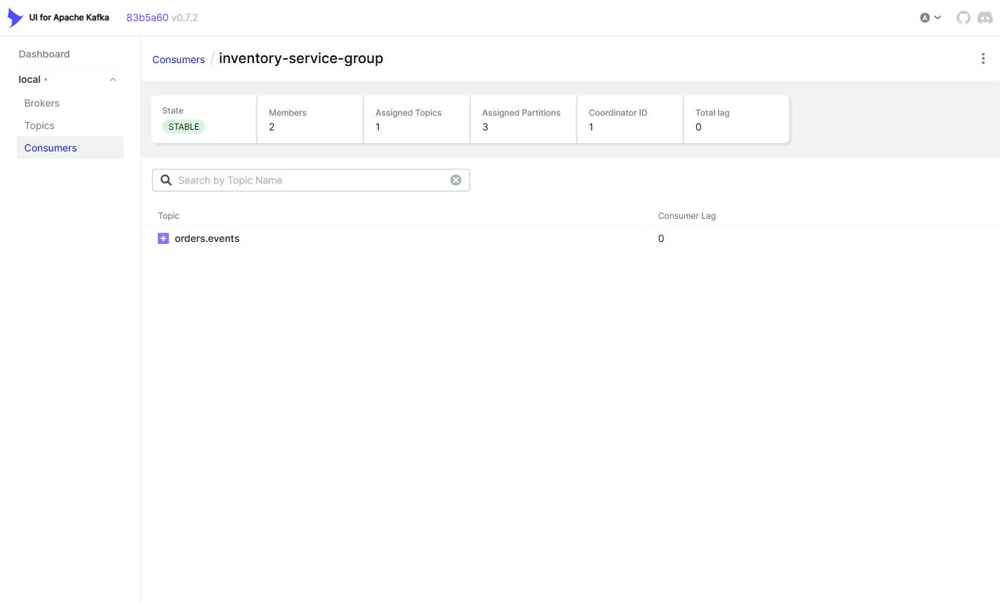

### CP-11 · Desacoplamiento temporal y consumidor posterior

| Campo | Contenido |
|---|---|
| **Arquitectura** | Kafka |
| **Objetivo** | A) Verificar que los eventos publicados con un consumidor apagado se procesan al iniciarlo. B) Prueba obligatoria del "consumidor posterior": un consumidor creado después de publicar los eventos los lee desde el log |
| **Precondiciones** | A) `notification-consumer` detenido. B) `audit-consumer` inexistente y sin offsets (grupo `audit-service-group` eliminado) |
| **Datos de entrada** | A) 3 pedidos `Temporal*`. B) Los 30 eventos ya existentes en el tópico |
| **Pasos** | **A)** 1) Detener notification. 2) Enviar 3 POST. 3) Consultar el lag. 4) Iniciar notification. **B)** 1) `kafka-get-offsets.sh` (total de eventos). 2) `docker compose --profile late up -d audit-consumer`. 3) Contar los eventos leídos |
| **Resultado esperado** | A) Lag = 3 y luego 0, con 3/3 procesados. B) El consumidor nuevo lee el 100 % de los eventos, empezando en el offset 0 |
| **Resultado obtenido** | **A)** Lag de `notification-service-group` = **3** (particiones 0, 1 y 2 con lag 0, 1 y 2) con el consumidor apagado. Al iniciarlo procesó **3/3** y el lag quedó en 0. **B)** `audit-consumer` se unió con las particiones 0, 1 y 2 y leyó **30/30 eventos**, empezando por `partition=1 offset=0` (`ORD-71822978`, publicado unos 4 minutos antes) |
| **Evidencia** | `evidencias/kafka/CP-11.log` · Figuras CP-11a, CP-11b y CP-11c |
| **Estado** | ✅ **Cumple** |
| **Análisis técnico** | Kafka retiene los eventos aunque ya se hayan consumido, así que un servicio nuevo puede reconstruir su estado leyendo el historial completo. Esto es imposible con una cola de RabbitMQ, donde el mensaje desaparece tras el `ack`. |

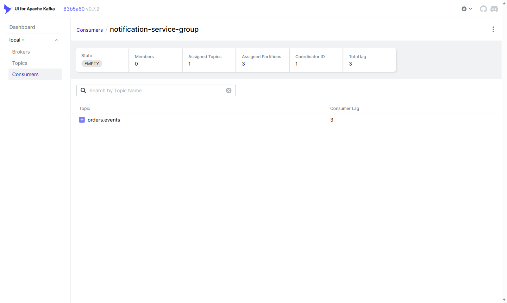

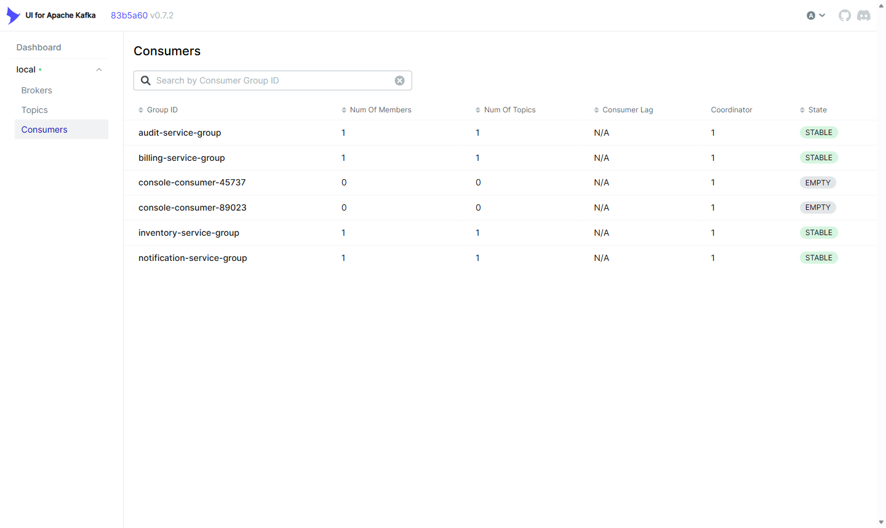

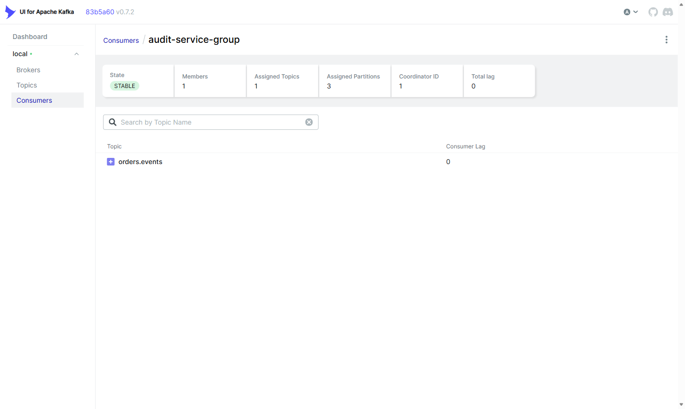

### CP-12 · Recuperación

| Campo | Contenido |
|---|---|
| **Arquitectura** | Kafka |
| **Objetivo** | Verificar que, tras reiniciar el consumidor o el broker, los eventos pendientes se procesan sin pérdida |
| **Precondiciones** | Entorno completo; volumen persistente para el log de Kafka |
| **Datos de entrada** | A) 6 pedidos `Recuperacion*`. B) 1 pedido durante el reinicio y 3 pedidos `PostReinicio*` |
| **Pasos** | **A)** 1) Enviar 6 POST. 2) Tras 2 eventos procesados, `docker compose kill inventory-consumer`. 3) Consultar el lag. 4) Iniciar el consumidor. **B)** 1) Contar los eventos. 2) `docker compose restart kafka`. 3) POST durante el arranque. 4) Contar los eventos. 5) Enviar 3 POST más |
| **Resultado esperado** | Ningún evento se pierde; los consumidores retoman desde su último offset confirmado; el log sobrevive al reinicio |
| **Resultado obtenido** | **A)** Lag tras el SIGKILL: **4** (particiones 0, 1 y 2 con lag 3, 0 y 1). Al reiniciar, el consumidor procesó todo: **0 perdidos, 0 reprocesados** en esta ejecución. En la ejecución anterior (31/10/2026) el mismo caso sí reprocesó un evento (`ORD-E17865F7`, ya procesado antes de la caída y vuelto a procesar en `partition=0 offset=10`). **B)** Eventos: **36 antes y 37 después** del reinicio (el log se conservó y se sumó el pedido enviado durante el arranque). Ese pedido respondió **HTTP 202 en 5321 ms**: kafkajs reintentó hasta que el broker volvió (`ECONNREFUSED` → `Failed to send messages`, retryCount 0). En la ejecución anterior la espera fue de 8274 ms. Los 3 pedidos posteriores (202 en 7–16 ms) fueron procesados por los 3 consumidores, y el lag final fue 0 en todos los grupos |
| **Evidencia** | `evidencias/kafka/CP-12.log` · Figura CP-12-K |
| **Estado** | ✅ **Cumple** |
| **Análisis técnico** | **Hallazgo:** kafkajs confirma los offsets al terminar cada lote, no después de cada mensaje. Un SIGKILL a mitad de lote hace que los eventos ya procesados pero no confirmados se reentreguen. Que ocurra o no depende del instante exacto de la caída: una ejecución lo mostró (1 duplicado) y la otra no (0), así que el riesgo no se puede descartar con una sola corrida limpia. La garantía es "al menos una vez", por lo que los consumidores deben ser **idempotentes**, por ejemplo descartando un `eventId` ya procesado. Este es un riesgo de calidad real que la prueba detectó. En el caso B, el productor retiene la petición HTTP mientras reintenta. No hay pérdida, pero un cliente con un timeout menor a 5–8 s vería un error aunque el pedido sí quedó registrado. |

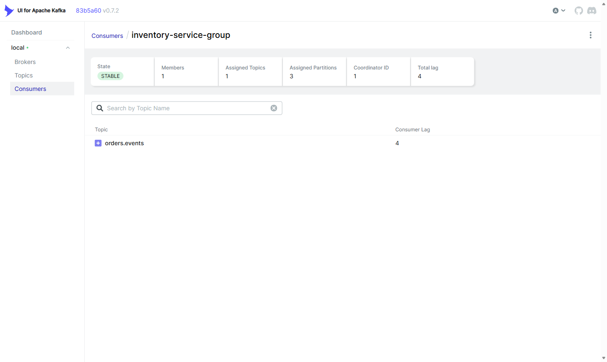

---

## 7. Resumen de resultados

| Caso | Propiedad / función | RabbitMQ | Kafka |
|---|---|---|---|
| Entorno | Montaje con Docker Compose | ✅ Cumple | ✅ Cumple |
| CP-01 | Creación de pedido vía API | ✅ Cumple | ✅ Cumple |
| CP-02 | Envío de mensaje a RabbitMQ | ✅ Cumple | N/A |
| CP-03 | Consumo de mensaje (RabbitMQ) | ✅ Cumple | N/A |
| CP-04 | Publicación de evento en Kafka | N/A | ✅ Cumple |
| CP-05 | Consumo de evento (Kafka) | N/A | ✅ Cumple |
| CP-06 | Trazabilidad del flujo | ✅ Cumple | ✅ Cumple |
| CP-07 | Responsive | ✅ Cumple (máx. 34,5 ms) | ✅ Cumple (máx. 43 ms) |
| CP-08 | Message-driven | ✅ Cumple | ✅ Cumple |
| CP-09 | Resilient | ✅ Cumple | ✅ Cumple |
| CP-10 | Elastic | ✅ Cumple (6 / 4) | ✅ Cumple (5 / 7) |
| CP-11 | Desacoplamiento temporal | ✅ Cumple | ✅ Cumple (+ consumidor posterior 30/30) |
| CP-12 | Recuperación | ✅ Cumple (0 perdidos) | ✅ Cumple (0 perdidos; 0 reprocesados, 1 en la corrida anterior) |
| **Total** | | **11 / 11** | **11 / 11** |

## 8. Conclusiones

### 8.1 ¿Qué arquitectura es más robusta desde QA?

Ambas cumplieron los 12 casos sin perder ningún pedido, pero **Kafka resultó más robusta desde la perspectiva de QA**, por tres razones observadas en las pruebas:

1. **La evidencia es persistente y repetible.** El log de Kafka se puede releer cuantas veces se necesite sin alterar el sistema: el consumidor posterior leyó 30/30 eventos y la lectura de CP-06 no modificó nada. En RabbitMQ, observar un mensaje dentro de la cola (*Get messages*) lo reentrega y altera la prueba (aparece `redelivered=true` en CP-06). Además, una vez confirmado, el mensaje deja de existir.
2. **El aislamiento de fallas es mayor.** Con tres grupos independientes, la caída de billing no afectó a inventario ni a notificación (CP-09), y el lag midió con exactitud el trabajo pendiente del servicio caído.
3. **La recuperación es más completa.** Además de resistir la caída del consumidor y del broker, Kafka permite reprocesar el historial completo, por ejemplo para corregir un consumidor defectuoso.

RabbitMQ, en cambio, ofrece **semántica por mensaje más precisa y fácil de verificar**. Ante la caída del worker reentregó exactamente el mensaje en curso, marcado con `redelivered=true`, mientras que Kafka, en una de las dos ejecuciones, reprocesó un evento ya completado porque confirma por lote (CP-12). Por eso, con Kafka la idempotencia de los consumidores no es opcional y debe incluirse explícitamente en el plan de pruebas.

### 8.2 Dificultades presentadas en las pruebas

| Dificultad | Cómo se detectó | Cómo se resolvió |
|---|---|---|
| **Incompatibilidad amqplib 0.10.4 con RabbitMQ 4.x**: la API y el worker no lograban conectarse (`read ECONNRESET`) y la API respondía 503 | El log del broker mostraba `negotiated frame_max = 4096 is lower than the minimum allowed value (8192)` | Se actualizó amqplib a 0.10.9. Esto demuestra el valor de revisar los logs **del broker** y no solo los de la aplicación |
| El healthcheck del broker en verde no garantiza que acepte clientes | Errores transitorios `The group coordinator is not available` en Kafka y reintentos al arrancar | Reintentos de conexión en todos los servicios, además de los healthchecks |
| Asincronía: el resultado no está disponible cuando responde la API | Comprobaciones inmediatas fallaban de forma intermitente | Esperas por condición (cola vacía, lag 0, línea de log) con tiempo máximo, en lugar de pausas fijas |
| Estados efímeros difíciles de capturar (Unacked, rebalanceo) | Con el worker activo, Unacked=1 dura entre 2 y 5 s | Detener el consumidor para "congelar" el estado y la opción `-Pausar` para tomar capturas en el momento exacto |
| La observación altera el sistema en RabbitMQ | `redelivered=true` en CP-06 después de usar *Get messages* | Se documentó como efecto de la observación, y se lee la cola solo con el consumidor detenido |
| Duplicados en Kafka tras una caída (`ORD-E17865F7`, ejecución del 31/10) | Conteo de `Evento procesado` por `orderId` en CP-12 | Se documentó como hallazgo. No se repitió en la ejecución final, lo que confirma que depende del instante de la caída. La recomendación es usar consumidores idempotentes por `eventId` |
| El reparto en Kafka no siempre es equitativo | Repartos de 9/3, 6/6 y 5/7 en ejecuciones distintas | Se explicó por el hash de la key; el criterio de aceptación es "ambas instancias procesan y no hay duplicados", no un reparto exacto |
| Ambas APIs usan el puerto 3000 | Conflicto al levantar las dos arquitecturas a la vez | Se ejecuta una arquitectura a la vez (`docker compose down` entre ellas) |
| Puerto 8080 ocupado en el equipo de la ejecución final | `docker compose up` falló con `bind: Solo se permite un uso de cada dirección de socket`; el puerto lo usaba `AgentService` | Se parametrizó el puerto de Kafka UI (`KAFKA_UI_PORT`, 8080 por defecto) y se usó 8081 |
| Los contadores de la consola de RabbitMQ se actualizan cada 5 s | Una captura tomada de inmediato mostraba Ready=3 cuando `rabbitmqctl` ya reportaba Ready=5 | Las capturas usan la página de detalle de la cola y esperan la siguiente actualización. El criterio de aceptación se calcula con `rabbitmqctl`, no con la consola |
| Kafka UI muestra "N/A" en la columna *Consumer Lag* de la lista de grupos | Aparece cuando alguna partición del grupo aún no tiene offset confirmado | Se verificó el lag con `kafka-consumer-groups.sh` y en la página de detalle de cada grupo (*Total lag*) |

### 8.3 Diferencias reales evidenciadas

| Aspecto | RabbitMQ (evidencia) | Kafka (evidencia) |
|---|---|---|
| Modelo | Cola de comandos (`ProcessOrder`): consumidores en competencia | Log de eventos (`OrderCreated`): cada grupo recibe todo |
| Destino de un mensaje | Un solo worker | Los 3 grupos recibieron el mismo `eventId` (CP-05) |
| Después del consumo | El mensaje se elimina tras el `ack` | El evento permanece: el consumidor posterior leyó 30/30 desde el offset 0 (CP-11) |
| Observabilidad | Contadores Ready / Unacked / Consumers | Offsets, log-end-offset y lag por grupo y partición |
| Reparto de carga | Por mensaje: 6/4 con `prefetch(1)` (CP-10) | Por partición: instancia A con {0,2}, instancia B con {1}; 5/7 en esta ejecución (CP-10) |
| Límite de escalado | Tantos workers como se quiera | Como máximo, igual al número de particiones (3) |
| Caída del consumidor | Solo se reentrega el mensaje en curso, con `redelivered=true` | Se retoma desde el último offset confirmado; 1 evento reprocesado en una de las dos ejecuciones (CP-12) |
| Reinicio del broker | Ready=3 conservado; la API se reconectó en 12 s | El log se conservó (36 → 37); una petición quedó retenida 5,3 s por los reintentos del productor (8,3 s en la ejecución anterior) |
| Complejidad de configuración | Baja (una imagen, dos puertos) | Mayor: listeners interno y externo, KRaft, creación del tópico y particiones |

**En síntesis:** RabbitMQ es la opción más simple y predecible para distribuir *trabajo* entre workers. Kafka es más adecuado cuando varios servicios deben reaccionar al mismo *hecho* y se necesita conservar y reprocesar el historial. Desde QA, Kafka ofrece mejor trazabilidad y recuperabilidad, pero exige probar explícitamente la idempotencia y el comportamiento ante rebalanceos.

## 9. Reproducibilidad

```powershell
# RabbitMQ
cd rabbitmq; docker compose up -d --build; cd ..
powershell -ExecutionPolicy Bypass -File pruebas\rabbitmq.ps1        # agrega -Pausar para tomar capturas
cd rabbitmq; docker compose down; cd ..

# Kafka
cd kafka; docker compose up -d --build; cd ..
powershell -ExecutionPolicy Bypass -File pruebas\kafka.ps1
```

El código fuente, los dos `docker-compose.yml`, los scripts de prueba, la colección de Postman y todos los archivos de evidencia y capturas están en el repositorio: https://github.com/JuanaOsp28/SistemaPedidos
